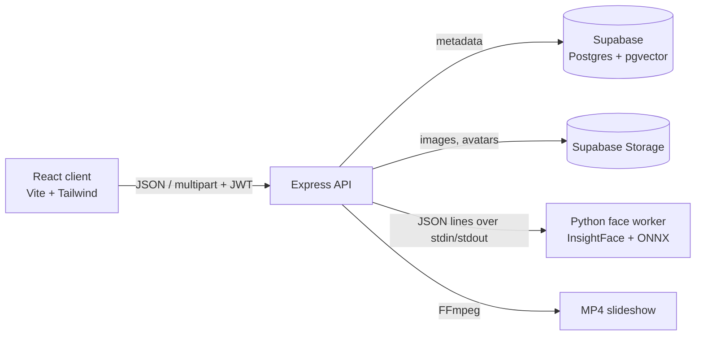
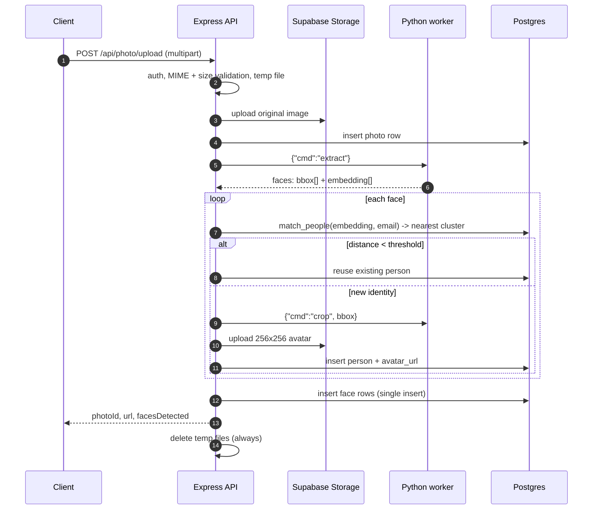

# VISION

**Visual Information Storage, Indexing and Organisation Network** - a privacy-first photo library that indexes the people in your photos, groups them automatically, and turns albums into slideshow videos.

VISION is a full-stack application: a React 19 + Vite client, an Express 5 API, and a local InsightFace pipeline that runs on your machine. Images are stored in Supabase Storage, metadata and 512-dimensional face embeddings are stored in PostgreSQL (`pgvector`), and inference never leaves your server.

---

## Contents

- [Features](#features)
- [Architecture](#architecture)
- [Quick start](#quick-start)
- [Configuration](#configuration)
- [Project structure](#project-structure)
- [Scripts](#scripts)
- [API](#api)
- [Testing](#testing)
- [Performance](#performance)
- [Security](#security)
- [Documentation](#documentation)
- [License](#license)

---

## Features

| Area | What it does |
| --- | --- |
| Library | Drag-and-drop upload, personal feed with lazy-loaded images, pagination-ready API |
| Face indexing | InsightFace `buffalo_l` detection + 512-d embeddings, one model loaded per server lifetime |
| People | Automatic clustering with cosine similarity, renameable people, per-person galleries |
| Live recognition | Webcam view that samples frames, draws boxes and labels known people (nothing is stored) |
| Albums | Multi-select album creation, curated or custom background music, cover thumbnails |
| Slideshow video | Server-side FFmpeg render (1280x720 H.264) with optional looping audio and cancellation |
| Accounts | Email/password signup and login, bcrypt hashes, JWT sessions, protected routes |
| Operations | Health endpoint, structured logs, validation, rate limiting, graceful shutdown, smoke test |

---

## Architecture



The API is the only component with database credentials. The browser never sees the Supabase service-role key.

### Upload pipeline



A failed upload rolls back the photo row, the storage object, and any person clusters that were created but never received a face.

See [docs/ARCHITECTURE.md](docs/ARCHITECTURE.md) for the full design, including the worker protocol and scaling notes.

---

## Quick start

### Prerequisites

- **Node.js 20+** (tested on Node 24)
- **Python 3.11-3.13** with a virtual environment (tested on 3.13)
- A **Supabase project** with the `vector` extension available
- No system FFmpeg install needed: the API uses the bundled `@ffmpeg-installer/ffmpeg` binary

### 1. Install dependencies

```bash
git clone <your-repo-url> VISION
cd VISION

npm run install:all

python -m venv python/venv
# Windows: python\venv\Scripts\activate
# macOS/Linux: source python/venv/bin/activate
pip install -r python/requirements.txt
```

The first face operation downloads the InsightFace `buffalo_l` models into `~/.insightface/models` (about 280 MB). This happens once.

### 2. Configure Supabase

1. Create two **public** storage buckets:
   - `vision` - original images
   - `avatars` - cropped face avatars
2. Open the SQL editor and run [`docs/database/schema.sql`](docs/database/schema.sql).
3. Copy the environment template:

```bash
cp server/.env.example server/.env
```

4. Fill in `SUPABASE_URL`, `SUPABASE_SERVICE_ROLE_KEY` and a long random `JWT_SECRET`:

```bash
node -e "console.log(require('crypto').randomBytes(48).toString('hex'))"
```

> The service-role key is a server secret. Never put it in the frontend, in `VITE_*` variables, or in git.

### 3. Run

```bash
npm run dev
```

| Service | URL |
| --- | --- |
| Web client | http://localhost:5173 |
| API | http://localhost:5000 |
| Health check | http://localhost:5000/api/health |

`npm run dev` starts both processes with prefixed logs. The API warms the face model at boot; the health endpoint reports `faceWorker.ready: true` when it is available.

If a previous run left an orphan behind (common on Windows after Ctrl+C), start from a clean slate with:

```bash
npm run stop       # terminates API, web, nodemon and the Python face worker
npm run dev
```

`npm run restart` runs both steps. If `npm run dev` reports that an API is already running, that instance was started outside the current terminal (often an orphan from Ctrl+C): run `npm run stop` first, or `npm run dev -- --reuse` to start only the web client against it.

### 4. Production build

```bash
npm run build          # type-checks and builds web/dist
npm start              # serves the API on PORT (5000 by default)
```

Serve `web/dist` from any static host. Set `VITE_API_URL` **at build time** to the public API origin, and set `CORS_ORIGIN` on the API to the web origin.

---

## Configuration

All server settings live in `server/.env` (see [`server/.env.example`](server/.env.example)).

| Variable | Default | Purpose |
| --- | --- | --- |
| `PORT` | `5000` | API port |
| `NODE_ENV` | `development` | `production` enables stricter errors/logging |
| `CORS_ORIGIN` | `*` | Comma-separated allowed browser origins |
| `JWT_SECRET` | - | **Required** in production |
| `JWT_EXPIRES_IN` | `7d` | Session lifetime |
| `BCRYPT_ROUNDS` | `12` | Password hashing cost |
| `SUPABASE_URL` | - | Supabase project URL |
| `SUPABASE_SERVICE_ROLE_KEY` | - | Server-only key |
| `PHOTOS_BUCKET` / `AVATARS_BUCKET` | `vision` / `avatars` | Storage buckets |
| `MAX_UPLOAD_MB` | `15` | Upload size limit |
| `FACE_MODEL` | `buffalo_l` | InsightFace model pack |
| `FACE_MATCH_THRESHOLD` | `0.6` | Cosine-distance cut-off for identity matching |
| `FACE_CTX_ID` | `-1` | `-1` = CPU, `0` = first GPU |
| `FACE_DET_SIZE` | `640` | Detector input size |
| `FACE_WARMUP` | `true` | Load the model at boot |
| `VIDEO_WIDTH` / `VIDEO_HEIGHT` | `1280` / `720` | Render resolution |
| `VIDEO_SECONDS_PER_PHOTO` | `4` | Slide duration |
| `LOG_LEVEL` | `debug` (dev) | `error`, `warn`, `info`, `debug` |

Frontend: `web/.env` (optional) supports `VITE_API_URL`. Leave it empty in development; Vite proxies `/api` to the API.

---

## Project structure

```text
VISION/
├── docs/
│   ├── API.md                  # endpoint reference
│   ├── ARCHITECTURE.md         # design, data flow, scaling
│   ├── AUDIT.md                # audit findings and fixes
│   ├── DATABASE.md             # schema, indexes, buckets
│   ├── TROUBLESHOOTING.md      # common failures
│   └── database/schema.sql     # idempotent migration
├── python/
│   ├── requirements.txt
│   ├── test.png                # sample image with faces
│   └── services/
│       ├── face_worker.py      # long-lived InsightFace worker (JSON lines)
│       ├── extract_faces.py    # CLI one-shot extractor (debugging)
│       └── crop_face.py        # CLI one-shot cropper (debugging)
├── scripts/dev.mjs             # runs API + web together
├── server/
│   ├── index.js                # bootstrap + graceful shutdown
│   ├── src/
│   │   ├── app.js              # Express app (helmet, CORS, routes, errors)
│   │   ├── config/             # env, Supabase, multer
│   │   ├── controllers/        # HTTP layer
│   │   ├── lib/                # errors, logger, async helpers, serializers
│   │   ├── middlewares/        # auth, validation, rate limit, error handler
│   │   ├── routes/             # /api/auth, /api/photo, /api/avatars, ...
│   │   ├── schemas/            # Zod request schemas
│   │   └── services/           # business logic + Python/FFmpeg integration
│   ├── scripts/smoke.mjs       # end-to-end smoke test
│   └── test/                   # node:test unit tests
└── web/
    ├── src/
    │   ├── lib/api.ts          # shared Axios client (JWT + 401 handling)
    │   ├── lib/auth.ts         # token helpers
    │   └── components/         # features + UI primitives
    └── vite.config.ts          # dev proxy + build config
```

---

## Scripts

| Command | What it does |
| --- | --- |
| `npm run install:all` | `npm ci` in `server` and `web` |
| `npm run dev` | API + web dev servers together |
| `npm run stop` | Terminate every VISION dev process (API, web, nodemon, face worker) |
| `npm run restart` | `stop` followed by `dev` |
| `npm run dev:server` / `npm run dev:web` | Run one side only |
| `npm run build` | Type-check and build the client |
| `npm start` | Start the API |
| `npm test` | Unit tests (auth, validation, helpers) |
| `npm run smoke` | End-to-end test against a running API |
| `npm run smoke -- --video` | Include a real MP4 render |
| `npm run smoke -- --keep` | Keep the disposable account for inspection |
| `npm run lint` | Oxlint on the client |

---

## API

All routes are prefixed with `/api`. Protected routes require `Authorization: Bearer <jwt>`.

| Method | Path | Description |
| --- | --- | --- |
| `GET` | `/api/health` | Liveness + face worker status |
| `POST` | `/api/auth/signup` | Create account, returns JWT |
| `POST` | `/api/auth/login` | Sign in, returns JWT |
| `GET` | `/api/auth/me` | Current profile (never includes the hash) |
| `POST` | `/api/photo/upload` | Upload + index one image (`photo` field) |
| `GET` | `/api/photo/feed?limit=&offset=` | Current user's photos |
| `POST` | `/api/photo/albums` | Create album |
| `GET` | `/api/photo/albums` | Albums with cover + count |
| `GET` | `/api/photo/albums/:id` | Album with photos |
| `GET` | `/api/photo/albums/:id/video` | Render/download MP4 |
| `GET` | `/api/avatars/people` | People clusters |
| `PUT` | `/api/avatars/people/:id` | Rename a person |
| `GET` | `/api/segregate/people/:id/photos` | Photos containing a person |
| `POST` | `/api/recognize` | Match a camera frame |

Full request/response examples: [docs/API.md](docs/API.md).

---

## Testing

```bash
npm test                              # fast unit tests, no database needed
npm run dev                           # in another terminal
npm run smoke -- --video              # full pipeline + video render
```

The smoke test creates a disposable account, uploads `python/test.png`, verifies clustering, recognition, albums and (with `--video`) FFmpeg rendering, then deletes every row and storage object it created.

---

## Performance

Key optimisations made in this version:

- **One Python process, one model load.** Previously every upload spawned a new Python process and loaded InsightFace from scratch (seconds per image). The worker now stays alive and is warmed at boot.
- **Crops no longer reload the image.** Avatar generation happens in the worker that already has the decoded image pipeline ready.
- **Single face insert.** All detected faces for an upload are written in one statement instead of one round-trip per face.
- **No album N+1.** Album listing is 2 queries regardless of album count (was `1 + 2N`).
- **Approximate nearest-neighbour search.** `match_people` returns one candidate and uses an HNSW index; the old query scanned and sorted every person.
- **Bounded concurrency.** Album media downloads run 4 at a time; the video download is cancellable end to end.
- **Sampled webcam recognition.** The client samples every 750 ms with an in-flight guard instead of firing 10 requests per second.
- **Route-level code splitting.** The main JS entry dropped from ~1.48 MB to ~240 KB; the heavy visual effects load only when needed.
- **Lazy images + explicit query columns** reduce bandwidth and payload size.

---

## Security

- The service-role key is server-only. The browser talks exclusively to this API.
- Passwords use bcrypt; hashes are never serialised to clients.
- JWTs are validated on every protected route; missing/invalid/expired tokens return `401` (previously the request could hang).
- Every album, photo, person and video route enforces ownership by email.
- Uploads are limited by MIME type and size; file extensions are derived from the MIME type, not the client filename.
- Helmet, a configurable CORS allow-list, validation (Zod) and per-route rate limits are enabled.
- Optional RLS statements are included in the schema to block direct PostgREST access.

> **Action required:** the original repository contained `server/.env` in git history with live Supabase credentials and a JWT secret. The file is no longer tracked, but history still contains it. Rotate the Supabase service-role key and the JWT secret in the Supabase dashboard, then update `server/.env`. See [docs/AUDIT.md](docs/AUDIT.md).

---

## Documentation

- [Architecture](docs/ARCHITECTURE.md)
- [API reference](docs/API.md)
- [Database guide](docs/DATABASE.md)
- [Audit report](docs/AUDIT.md)
- [Troubleshooting](docs/TROUBLESHOOTING.md)

---

## License

MIT - see [LICENSE](LICENSE).

---

*Restructured and hardened as VISION.*
# VISION
# VISION
# VISION
