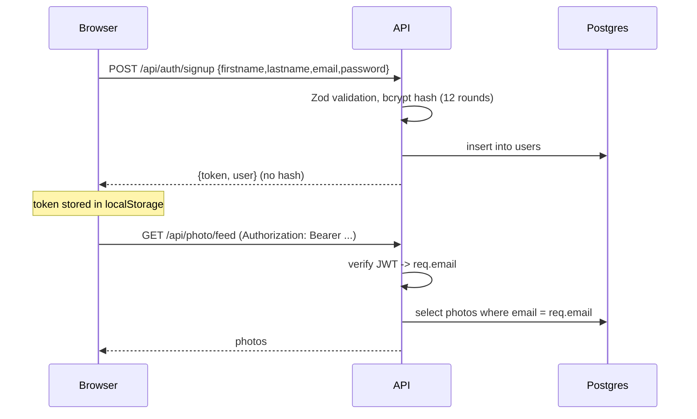
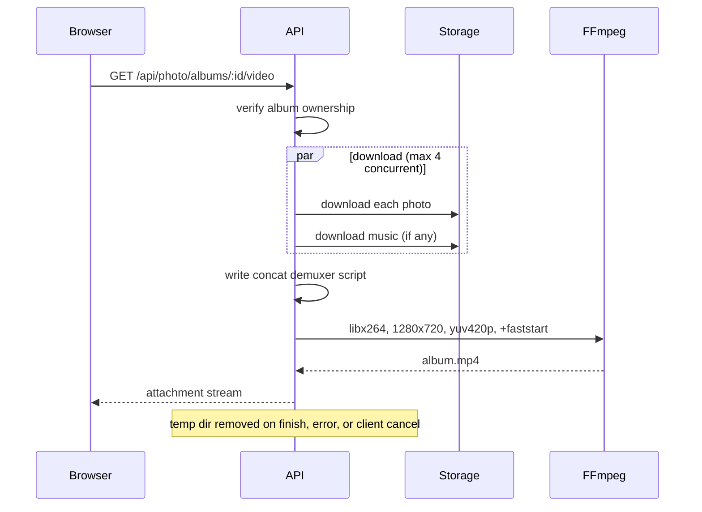

# Architecture

VISION is split into three runtime components:

| Component | Runtime | Responsibility |
| --- | --- | --- |
| Web client | Browser (React 19, Vite) | UI, routing, uploads, camera sampling, playback |
| API | Node.js 20+ (Express 5) | Auth, validation, ownership, orchestration, video delivery |
| Face worker | Python (InsightFace, ONNX Runtime) | Detection, embeddings, avatar cropping |
| Data | Supabase | Postgres + pgvector, object storage |

The API is the trust boundary. It holds the service-role key, verifies JWTs, and scopes every query by account email.

---

## Request flow

### Authentication



`POST /api/auth/login` verifies the hash and always performs a bcrypt comparison (against a dummy hash for unknown accounts) so response timing does not reveal whether an email exists.

### Ingestion

1. `uploadLimiter` and `authMiddleware` run before the body is parsed, so unauthenticated or abusive requests never allocate image buffers.
2. Multer accepts one file with a 15 MB cap and a JPEG/PNG/WebP MIME allow-list.
3. The buffer is written to a temporary file only because OpenCV needs a path.
4. The original is uploaded to Supabase Storage and a `photos` row is inserted.
5. The worker extracts faces. For each embedding, `match_people` returns the nearest cluster:
   - distance `< FACE_MATCH_THRESHOLD` -> attach to the existing person;
   - otherwise -> create a person, crop an avatar, upload it, and set `avatar_url`.
6. All face rows are inserted in one statement.
7. Temporary files are deleted in `finally`. Failures trigger a compensating rollback (photo row, storage object, unused clusters).

### Live recognition

The browser captures a frame every 750 ms, guarded by an in-flight flag, and posts it to `/api/recognize`. The API reuses the same warm worker, extracts embeddings, and matches each one. No image or embedding is persisted. Boxes are drawn on an overlay canvas in source-video coordinates.

### Album video



Audio is looped and `-shortest` cuts the output at the end of the last slide. If the client aborts, the request `close` handler kills FFmpeg and removes the temporary directory.

---

## Face worker protocol

The worker (`python/services/face_worker.py`) is started with the Node process and communicates over newline-delimited JSON. Protocol output goes to the real `stdout`; all InsightFace/OpenCV logging is redirected to `stderr`.

```jsonc
// request
{"id": 7, "cmd": "extract", "path": "C:/VISION/server/uploads/abc.jpg"}
{"id": 8, "cmd": "crop", "path": "...", "bbox": [x1,y1,x2,y2], "out": "..."}
{"id": 9, "cmd": "ping"}
{"id": 10, "cmd": "shutdown"}

// response
{"type": "ready", "model": "buffalo_l", "ctx_id": -1, "det_size": 640}
{"id": 7, "ok": true, "count": 2, "faces": [{"bbox": [...], "embedding": [...]}]}
{"id": 8, "ok": true, "out": "..."}
{"id": 7, "ok": false, "error": "...", "errorType": "FileNotFoundError"}
```

Node side (`server/src/services/faceService.js`):

- spawns lazily on the first command (or at boot with `FACE_WARMUP=true`);
- tracks pending request ids with per-command timeouts (120 s extract, 30 s crop);
- rejects all pending requests if the child exits, and restarts it on the next request;
- reports readiness through `GET /api/health`;
- shuts the worker down gracefully on SIGINT/SIGTERM.

Only one command runs at a time inside the worker. That is intentional: ONNX on CPU is already parallel internally, and serialising avoids memory spikes. Concurrent uploads are queued rather than rejected.

To use a GPU, install `onnxruntime-gpu`, set `FACE_CTX_ID=0`, and leave the NVIDIA runtime available to the process.

---

## Layering

```text
routes          HTTP shape, middleware order, rate limits
controllers     translate services into responses
schemas         Zod validation
services        business rules, ownership, Supabase/worker/FFmpeg calls
config          environment, Supabase client, multer
lib             errors, logger, mapLimit, serializers
```

Rules kept consistent across the codebase:

- Services throw typed `HttpError`s; the central error handler maps them to JSON.
- Ownership is always filtered in SQL (`eq('email', req.email)`), never only in JavaScript.
- Uploads/renders clean up temporary state in `finally`.
- Responses never include `hashedpassword` or service credentials.
- Limits are enforced at the edge (rate limiter, multer) before expensive work.

---

## Reliability and failure modes

| Failure | Behaviour |
| --- | --- |
| Python worker crashes | Pending jobs fail with `503`; next request respawns the worker |
| Model download missing | Worker exits with a fatal message; `/api/health` shows `ready: false`; uploads return `503` |
| Supabase unreachable | Services return `502/500` with a safe message; stack traces only in development |
| Storage bucket missing | Upload fails with a descriptive storage error; photo row is rolled back |
| FFmpeg fails | Video endpoint returns `502`; temp directory is removed |
| Client cancels upload/video | Request close aborts FFmpeg and removes temp files |
| Server shutdown | Listener closes, worker is disposed, 10 s hard-stop guard |

---

## Scaling path

The current design targets a single API node with a local worker, which is appropriate for a personal or small-team library.

For horizontal scale:

1. Replace the in-memory rate limiter with Redis or an edge limiter.
2. Move face jobs to a queue (BullMQ/SQS) and run workers as a separate deployment, keeping the same JSON protocol.
3. Serve uploads directly to storage with signed URLs, or add a CDN in front of the public buckets.
4. Cache rendered album videos by `(album_id, updated_at)` in storage instead of re-rendering on every request.
5. Use a connection pooler (PgBouncer/Supavisor) if the API concurrency grows.
6. Enable RLS and use per-user Supabase JWTs if clients ever query the database directly.

---

## Frontend design

- `web/src/lib/api.ts` is the single Axios instance: base URL from `VITE_API_URL` (empty in dev to use the Vite proxy), JWT injection, and global `401` handling.
- `RequireAuth` guards every private route and remembers the intended destination.
- Routes are `React.lazy` loaded, so the landing animation and Three.js effects are not part of the initial bundle.
- `AbortController` cancels in-flight video downloads on unmount.
- The camera loop samples at 750 ms with an in-flight guard to keep CPU and request volume bounded.

---

## Why these choices

**Persistent worker instead of FastAPI service.** A local subprocess keeps inference private and requires no extra port, deployment, or auth surface, while removing the per-request model load that dominated the old implementation.

**pgvector instead of an external vector database.** Face clusters are small per user, and keeping vectors next to relational data removes a sync problem. An HNSW index makes nearest-neighbour lookup cheap.

**Supabase Storage + Postgres.** Managed auth/storage/backups are not needed for this project's scope, but object storage and SQL are. Supabase provides both without operating infrastructure.

**Express 5.** Native async error propagation removes the wrapper boilerplate the old code lacked (which caused hanging requests on auth failures).
