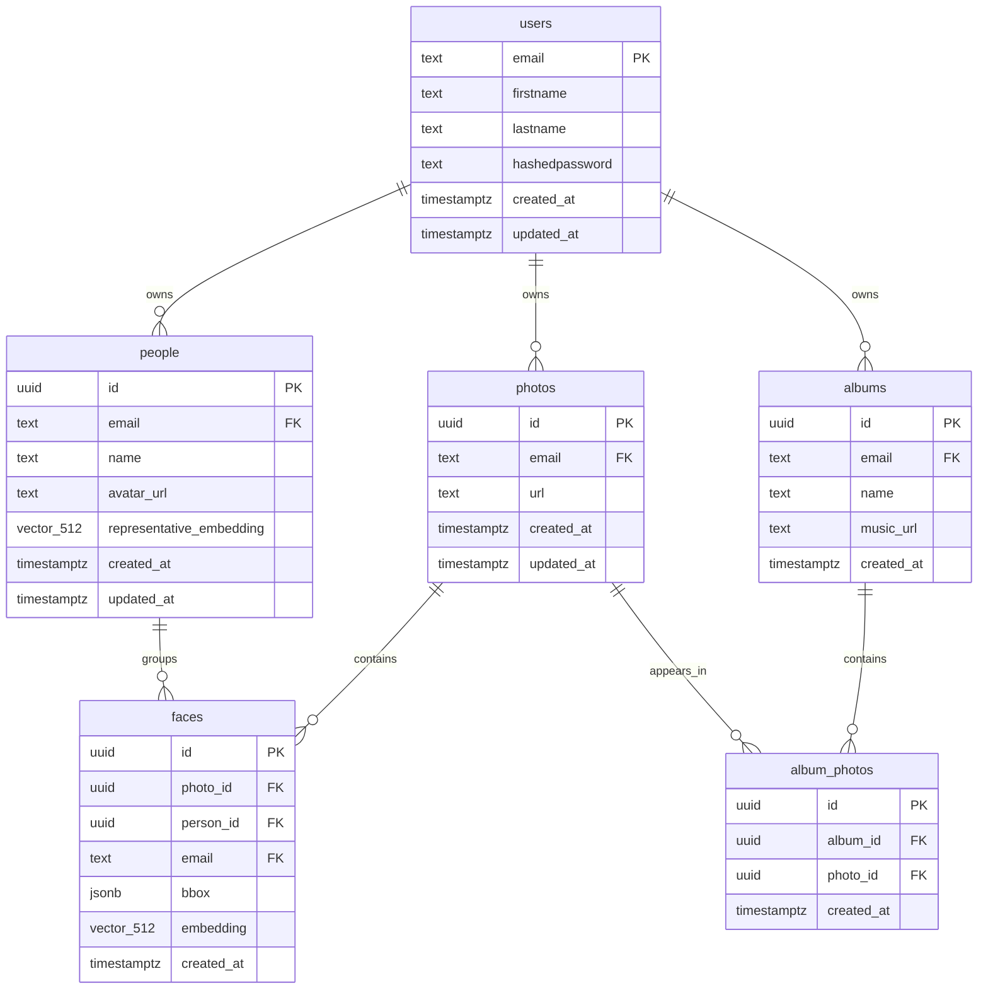

# Database Guide

VISION uses a Supabase project for PostgreSQL 15+ with the `vector` extension, plus two storage buckets.

The complete, idempotent schema is in [`database/schema.sql`](database/schema.sql). Apply it in the Supabase SQL editor before starting the API.

---

## Entity relationship



All foreign keys use `ON DELETE CASCADE`, so deleting a user removes their photos, faces, people and albums. Deleting a photo removes its face rows and album links.

---

## Tables

| Table | Purpose | Notes |
| --- | --- | --- |
| `users` | Accounts | Email is the primary key and the tenancy key for every query |
| `photos` | Original images | `url` points at the public `vision` bucket |
| `people` | Face clusters | One row per identity; `representative_embedding` is used for matching |
| `faces` | Individual detections | `bbox` is `[x1, y1, x2, y2]` in source-image pixels |
| `albums` | Album metadata | `music_url` may be empty |
| `album_photos` | Album membership | Unique `(album_id, photo_id)` |

### Face embeddings

- Dimension: **512** (InsightFace `buffalo_l` / ArcFace).
- Operator: cosine distance `<=>`.
- Threshold: `0.6` by default (`FACE_MATCH_THRESHOLD`). Lower is stricter.
  - `0.35-0.45` - very strict, more duplicate people
  - `0.55-0.65` - balanced (default)
  - `0.70+` - permissive, risks merging different people
- Embeddings are normalised by the model, so cosine distance is the right measure.

### Matching function

```sql
create or replace function public.match_people(
  query_embedding vector(512),
  user_email text
)
returns table (id uuid, distance double precision)
language sql stable
as $$
  select p.id,
         (p.representative_embedding <=> query_embedding)::double precision
  from public.people p
  where p.email = user_email
    and p.representative_embedding is not null
  order by p.representative_embedding <=> query_embedding
  limit 1;
$$;
```

Returning a single row is what allows PostgreSQL to use the HNSW index. The API treats a missing row as "no clusters yet".

### Indexes

| Index | Supports |
| --- | --- |
| `photos_email_created_at_idx` | Feed query (`email`, newest first) |
| `people_email_idx` | Tenant filter for people lists and matching |
| `people_embedding_hnsw_idx` | Cosine nearest-neighbour search |
| `faces_person_id_idx` | Person galleries |
| `faces_photo_id_idx` | Photo deletion / joins |
| `faces_email_idx` | Tenant-scoped face queries |
| `albums_email_created_at_idx` | Album listing |
| `album_photos_album_id_idx` | Album detail + cover lookup |
| `album_photos_photo_id_idx` | Photo deletion |

The HNSW index is created with `vector_cosine_ops` and a `WHERE representative_embedding IS NOT NULL` predicate. For very small datasets PostgreSQL may choose a sequential scan; that is fine. Run `ANALYZE people;` after large imports.

---

## Storage buckets

Create these in **Storage** in the Supabase dashboard:

| Bucket | Public | Contents | Path convention |
| --- | --- | --- | --- |
| `vision` | yes (read) | Original uploads | `<uuid>.<jpg\|png\|webp>` |
| `avatars` | yes (read) | 256x256 face crops | `<personId>.jpg` |

The API uploads with the service role, so bucket write policies are not required. Public read is required because the client renders URLs directly. For stricter privacy, switch to a private bucket and replace public URLs with signed URLs in the API response.

The bundled music tracks in the default album templates use a third bucket (`Music`) from the original project. You can point them at any public URL, or copy the tracks into your own bucket and update `DEFAULT_TRACKS` in `web/src/components/features/albums/Albums.tsx`.

---

## Applying the schema

1. Supabase dashboard -> SQL editor -> new query.
2. Paste [`database/schema.sql`](database/schema.sql) and run.
3. Verify:

```sql
select tablename, indexname
from pg_indexes
where schemaname = 'public'
order by tablename, indexname;

select proname from pg_proc where proname = 'match_people';
```

If you are upgrading an existing database, the script preserves rows and adds the missing `people.name`, `updated_at` columns, triggers, indexes, and replaces `match_people`.

> If your existing `people` table has a `representative_embedding` column with a different dimension, do not run the vector index statement until the data matches `vector(512)`.

---

## Row Level Security

The API uses the service-role key, which bypasses RLS. The schema therefore works with RLS both on and off.

Recommended hardening: enable RLS on all six tables with **no policies**. This blocks direct access through the anon key while leaving the API unaffected. The statements are at the bottom of `schema.sql` and can be uncommented.

```sql
alter table public.users        enable row level security;
alter table public.photos       enable row level security;
alter table public.people       enable row level security;
alter table public.faces        enable row level security;
alter table public.albums       enable row level security;
alter table public.album_photos enable row level security;
```

If you later use Supabase Auth tokens directly from the browser, add per-user policies instead of leaving the tables closed.

---

## Consistency notes

Supabase's REST API does not expose multi-statement transactions to the client. The API compensates explicitly:

- Upload failure -> delete the photo row and storage object; delete clusters that received no faces.
- Album creation failure -> delete the album row (links cascade).
- Deleting a user -> cascade handles all child rows; storage objects must be removed separately.

For large migrations or bulk imports, use `psql` with explicit transactions instead of PostgREST.

---

## Capacity planning

- One `faces` row is roughly 2 KB (512 floats + bbox + ids).
- 50k photos with two faces each is ~200 MB of face data before indexes.
- HNSW memory scales with the number of `people`, not `faces`, so it stays small.
- Public storage egress is the usual cost driver; add a CDN for large libraries.
- `GET /api/photo/feed` is paginated; the client requests the first 100 by default.

---

## Backups and retention

Supabase provides daily backups on paid plans. For a self-managed Postgres:

```bash
pg_dump --no-owner --no-privileges "$DATABASE_URL" > vision-$(date +%F).sql
```

Storage objects are not included in database backups; sync the buckets with `rclone` or the Supabase CLI if you need a full copy.
